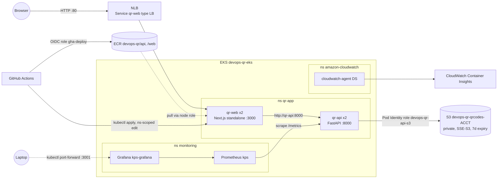

# DevOps QR capstone

A small QR-code generator, a Next.js front end and a FastAPI back end, shipped the DevOps way:
containers, a local Kubernetes copy on kind, Terraform for AWS (EKS, ECR, S3), GitHub
Actions for CI/CD with OIDC (no stored keys), and monitoring with Prometheus/Grafana plus
CloudWatch Container Insights.

Every step from a clean laptop to a public URL, and back to zero cost, is a `make` target.
The only manual steps are installing the tools and logging in to AWS and GitHub.

> **Status:** the local flows (compose, kind) and the AWS deploy have both been run; the
> results are under [What has been verified](#what-has-been-verified). Teardown (`make nuke`,
> `make verify-clean`) is scripted but has not been run on AWS yet.

## Architecture



The browser only talks to `qr-web`. Its `/api/*` route handlers call the API inside the
cluster, so the API is never public. The API stores each PNG in a private S3 bucket under a
content hash and streams it back through the web app. Full design: [docs/DESIGN.md](docs/DESIGN.md).

## Quick start

Prerequisites: macOS with Homebrew (`make tools` installs Colima and the docker CLI;
Docker Desktop with at least 6 GB of RAM also works instead), a
standard AWS account (not AWS Academy / Learner Lab), and a GitHub account.

```bash
make tools                 # once: installs every CLI from the Brewfile (incl. Colima + docker)
colima start --cpu 4 --memory 8   # once per boot; skip if Docker is already running
aws login                  # human step: IAM admin user, not root (or: aws sso login)
gh auth login              # human step
make doctor                # tools, Docker, logins

# optional local proof
make test lint local-up local-smoke local-down
make kind-up kind-deploy kind-smoke kind-down

# cloud
git init -b main && git add -A && git commit -m "Initial commit"   # gh-repo refuses a dirty tree
make gh-repo               # private repo, push main (CI green, AWS jobs skipped)
make up                    # bootstrap -> infra-up (~15-20 min) -> platform-up -> release -> smoke-test
make url                   # http://<nlb-dns>
make grafana               # http://localhost:3001
make nuke                  # back to $0; ends with verify-clean
```

`make help` lists every target. [docs/RUNBOOK.md](docs/RUNBOOK.md) gives the exact commands
each one runs, what success looks like, troubleshooting and teardown verification.

| Group | Targets |
|---|---|
| Setup | `help`, `tools`, `doctor` |
| Quality | `lint`, `test`, `fmt` |
| Local (compose) | `build`, `local-up`, `local-smoke`, `local-logs`, `local-down` |
| Local (kind) | `kind-up`, `kind-deploy`, `kind-smoke`, `kind-monitoring`, `kind-down` |
| GitHub | `gh-repo`, `gh-setup`, `gh-teardown [SCOPE=main\|all]` |
| Cloud up | `bootstrap`, `infra-plan`, `infra-up`, `kubeconfig`, `platform-up`, `monitoring-up [CLUSTER=eks\|kind]`, `release`, `deploy`, `url`, `smoke-test`, `grafana [CLUSTER=eks\|kind]`, `status`, `up` |
| Teardown | `lb-cleanup`, `infra-down`, `nuke`, `verify-clean` |

## Repository layout

| Path | What |
|---|---|
| `api/` | FastAPI service, its tests and Dockerfile (`test` and `runtime` stages) |
| `front-end-nextjs/` | Next.js app with `/api/*` proxy routes and Dockerfile (`test` and `runtime` stages) |
| `compose.yaml` | Local stack: MinIO, bucket init, API, web |
| `k8s/` | Kustomize `base` plus overlays `local` (kind) and `eks`; `kind/cluster.yaml`; `namespace.yaml` |
| `monitoring/` | kube-prometheus-stack values and the "QR services" Grafana dashboard |
| `infra/bootstrap/` | Terraform, local state: state bucket, GitHub OIDC provider, CI roles |
| `infra/main/` | Terraform, S3 state: VPC, EKS, add-ons, ECR, S3, Pod Identity, log groups |
| `scripts/` | Every automation step; `lib.sh` holds the shared helpers |
| `.github/workflows/` | `app.yml`, `infra.yml`, `lint.yml` |
| `Makefile` | The entry point; `make help` |
| `project.env`, `tool-versions.env` | Project constants and pinned tool versions, shared by scripts, Makefile and CI |
| `Brewfile` | Every CLI tool (`make tools`) |

## CI/CD

| Workflow | Runs on | What it does |
|---|---|---|
| `app.yml` | changes to `api/`, `front-end-nextjs/`, `k8s/`, `compose.yaml`, deploy scripts; manual dispatch | `test` (each app's Dockerfile `test` stage), `manifests` (kustomize + kubeconform), `build` (PRs: linux/amd64, no push), `publish` (main: push `:<git-sha>` to ECR, skipped if the tag exists), `deploy` (main: `scripts/deploy.sh eks <sha>`, then the smoke test against the public URL) |
| `infra.yml` | changes to `infra/` | `static` (fmt, validate, tflint) and a read-only `plan` written to the job summary. No apply job: Terraform applies only from the laptop. |
| `lint.yml` | changes to scripts, Makefile, workflows, monitoring, Dockerfiles | actionlint, shellcheck, hadolint, `helm template` + kubeconform, dashboard JSON check |

- AWS access is OIDC only (`aws-actions/configure-aws-credentials`); the repo has no secrets.
- Every AWS job is gated on repo variables (`vars.*`). Until `make bootstrap`/`make infra-up`
  set them, those jobs are skipped and the run is green. `make infra-down` deletes the
  cluster variables so pushes stop deploying.
- Third-party actions are pinned to full commit SHAs.
- `make release` dispatches `app.yml` on `main` and waits for it.

## Monitoring

- **Prometheus + Grafana** (kube-prometheus-stack, release `kps`, namespace `monitoring`):
  `make monitoring-up` (EKS) or `make kind-monitoring`, then `make grafana` opens a
  port-forward at `http://localhost:3001` and prints the login. The "QR services" dashboard
  shows request rate, 5xx ratio, p95 latency, QR codes per minute, storage errors, and
  CPU, memory, restarts, replicas and network for both apps.
- **CloudWatch Container Insights** (EKS add-on, metrics only): AWS console → CloudWatch →
  Container Insights → cluster `devops-qr-eks`.

## Cost

About **$0.37/hour (~$9/day)** in us-east-1 while the cluster runs (EKS control plane
$0.10/h, 2 × m7i-flex.large, public IPv4, one NLB, Container Insights). No NAT gateway.
The node type is one the AWS Free account plan allows; on a Paid plan, t3a.medium brings
it to about $0.25/hour.
`make nuke` deletes everything and `make verify-clean` checks nothing billable is left.
The cost table is in the [RUNBOOK](docs/RUNBOOK.md#cost).

## Why no Ansible

The brief's configuration-management needs are covered by EKS managed node groups (AWS
builds and patches the nodes from the AL2023 EKS AMI) and by the Kubernetes manifests
(declarative app config). There are no long-lived hosts to configure, so Ansible would have
nothing to manage.

## What has been verified

Checked on 19 Nov 2026 (macOS arm64, Colima):

| Check | Result |
|---|---|
| `make lint` (shellcheck, actionlint, hadolint, terraform fmt/validate, tflint, kustomize + kubeconform, helm template) | pass |
| `make test` (API: ruff + 18 pytest tests with moto; web: eslint) | pass |
| `make local-up local-smoke local-down` (Docker Compose + MinIO) | pass |
| `make kind-up kind-deploy kind-smoke kind-monitoring` | pass: POST `/api/qr` returns 201 and the PNG is served; Prometheus target `qr-api` is up with route-labelled request metrics; Grafana loads the `qr-services` dashboard |
| GitHub Actions on the first push (`lint`, `app`, `infra`) | green; AWS jobs skip until `make gh-setup` sets the repo variables |
| PR build job: both images built for `linux/amd64` with buildx (the EKS target) | pass |

Run on AWS on 24 Nov 2026 (new Free-plan account, us-east-1, EKS 1.36):

| Check | Result |
|---|---|
| `make bootstrap` | pass: 11 resources |
| `make infra-up` | pass: 66 resources in 15 minutes, 2 nodes Ready |
| `make platform-up` | pass: Prometheus and Grafana running |
| CI release (OIDC sign-in, ECR push, deploy to EKS, smoke test) | pass |
| `make smoke-test` on the public NLB URL | pass: POST `/api/qr` returns 201 and the PNG is served |
| S3 through Pod Identity | pass: the object is stored; reading it directly from S3 without credentials returns 403 |
| Prometheus and Grafana on EKS | pass: both `qr-api` targets up, all 14 dashboard panels return data |
| Container Insights | pass: node and `qr-app` pod metrics in CloudWatch |

Screenshot and pipeline runs: [docs/EVIDENCE.md](docs/EVIDENCE.md).

**Not yet run against AWS:** `nuke` and `verify-clean`.

## Attribution

The sample application comes from
[rishabkumar7/devops-qr-code](https://github.com/rishabkumar7/devops-qr-code)
(MIT License, Copyright (c) 2023 Rishab Kumar; see [LICENSE](LICENSE)). This repository
reworks the app and adds the containers, infrastructure, pipelines and automation.
