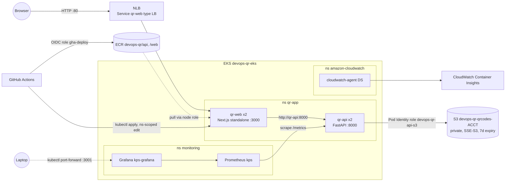

# DevOps QR Capstone: Design

Status: proposed (19 Nov 2026), with open questions in §14. Builders A, B and C implement from this doc in parallel.
**§10 (contract) is binding.** If any other section of this doc disagrees with §10, follow §10. If you need to change a contract value, stop and ask the orchestrator; do not change it on your own.
Versions marked *verified* were looked up on 19 Nov 2026. Anything marked *pin at build time* comes with the command to look it up.

---

## 1. Decisions

| # | Decision | Choice | Why (one line) |
|---|---|---|---|
| D1 | Public entry on EKS | `Service type: LoadBalancer` on `qr-web`, annotation `service.beta.kubernetes.io/aws-load-balancer-type: nlb`, created by EKS's built-in (in-tree) controller. No AWS Load Balancer Controller, no Ingress, no Auto Mode. | One NLB, no extra controller, no extra IAM or Auto Mode fee, and it disappears when the Service is deleted. |
| D2 | Browser → API | Same origin. Next.js route handlers under `/api/*` proxy to `API_INTERNAL_URL`, which is read **per request**. The API is a ClusterIP service and is never public. | One web image runs unchanged in compose, kind and EKS. No CORS. No URL baked in at build time. |
| D3 | Serving the QR image | The bucket stays **private**. `GET /v1/qr/{id}` on the API streams the object from S3, and the web app proxies it as `/api/qr/{id}`. | A presigned URL would be signed for the in-cluster MinIO host, which the browser cannot reach locally. Streaming needs no second endpoint and no bucket CORS. |
| D4 | Pod → AWS identity | **EKS Pod Identity**, for the API's S3 role and the CloudWatch agent role. | No per-cluster OIDC provider and no ServiceAccount annotations, so the manifests are identical on kind and EKS. |
| D5 | Network | VPC across 2 AZs with **public subnets only**: no NAT gateway, no VPC endpoints. Nodes get public IPs. Their security groups allow only cluster traffic and the NLB's NodePort (see risk 13). | A NAT gateway costs $0.045/h plus data, more than both nodes. Interface endpoints cost more than the NAT. |
| D6 | Compute | One managed node group: 2 × `t3a.medium` (`t3.medium` as fallback; the code now defaults to `m7i-flex.large`, which the AWS Free plan allows), ON_DEMAND, AL2023 x86_64, 20 GiB gp3. | Pod-slot math is in §5.3. On-demand keeps the graded demo predictable, and Spot would save only about $1.30/day. |
| D7 | IaC layout | `infra/bootstrap` (local state): state bucket, GitHub OIDC provider, CI roles. `infra/main` (S3 backend, native `use_lockfile`): everything else. | Destroying `main` can never delete the CI roles or the state bucket. DynamoDB locking is deprecated. |
| D8 | Manifests | **Kustomize**: `k8s/base` plus overlays `local` (kind) and `eks`. At deploy time the image tag (git SHA) and the bucket/region are set in a **temp copy** with `kustomize edit`. Nothing is committed back. | Plain YAML is easy to grade. No Helm templating for our own apps. The git tree stays clean. |
| D9 | App delivery | GitHub Actions on push to `main`: test → build linux/amd64 → push to ECR (`:<sha>`) → `kubectl apply` → smoke test. | Meets the brief's "deploy when source changes" requirement, with OIDC only. |
| D10 | Infra delivery | `terraform apply`/`destroy` run **only from the laptop** via `make`. CI runs fmt, validate and tflint, plus a **read-only plan**. | An apply role would need near-admin IAM, and the teardown ordering (LB cleanup) lives in scripts. |
| D11 | Monitoring | Container Insights add-on (metrics only, container logs off) **and** kube-prometheus-stack (no Alertmanager, no PVCs). ServiceMonitor comes from Helm values. Grafana is reached by port-forward. | Both are required. The lean settings fit 2 small nodes and leave no EBS volumes behind. |
| D12 | Local S3 | MinIO from `cgr.dev/chainguard/minio` pinned by digest. The bucket is created by an `amazon/aws-cli:2.41.1` one-shot. Fallback: `motoserver/moto:5.2.5`. | `minio/minio` is gone from Docker Hub (verified) and Chainguard is the only maintained MinIO image that pulls. |
| D13 | Kubernetes version | `1.36` on EKS (a Terraform variable) and the kind node image `v1.36.x` from kind v0.33.0. | The AWS docs list 1.36 under standard support (not confirmed); the `infra-up` preflight enforces it. Keeping the same minor version gives local/cloud parity. |
| D14 | Tests | Tests run inside Dockerfile stages (`docker build --target test`), using the same command on the laptop and in CI. | No local Python or Node toolchain to install, and CI behaves the same as the laptop. |
| D15 | Region | `us-east-1` (a variable) | Cheapest and offers everything; AZs are chosen by zone ID to skip `use1-az3`. |

---

## 2. Architecture



**Request flow**
1. `POST /api/qr {"url":"https://example.com"}` from the browser goes to `qr-web`. The route handler sends `POST ${API_INTERNAL_URL}/v1/qr`.
2. The API validates the URL, takes `id = sha256(url)`, renders a PNG, and calls `PutObject s3://$S3_BUCKET/qr_codes/<id>.png`. It returns `201 {"id","key"}`.
3. `qr-web` returns `201 {"id","image_url":"/api/qr/<id>"}`. The browser renders `">`.
4. `GET /api/qr/<id>` goes to `qr-web`, then `GET /v1/qr/<id>` on the API, then `GetObject` on S3. The PNG is streamed back with `Cache-Control: public, max-age=31536000, immutable`, which is safe because the content is addressed by its hash.

**Environments**

| | compose (`make local-up`) | kind (`make kind-deploy`) | EKS (`make up`) |
|---|---|---|---|
| Entry | `http://localhost:3000` | `http://localhost:8080` (NodePort 30080) | `http://<nlb-dns>` (`make url`) |
| S3 | `qr-s3` MinIO, bucket `qr-codes-local` | same image, in-cluster | real S3 bucket from Terraform |
| S3 creds | env vars `AWS_ACCESS_KEY_ID`/`AWS_SECRET_ACCESS_KEY` (dev values) | Secret `qr-s3-credentials` (local overlay only) | Pod Identity, no keys |
| `S3_ENDPOINT_URL` | `http://qr-s3:9000` | `http://qr-s3:9000` | unset (AWS default) |
| Images | `qr-api:dev`, `qr-web:dev`, built natively on the laptop (arm64) | same, loaded with `kind load` | `ECR/devops-qr/{api,web}:<sha>`, built linux/amd64 by CI |
| Monitoring | none | `make kind-monitoring` (kps only) | kps + Container Insights |

---

## 3. App changes (Builder A)

### 3.1 API (`api/`)
- **Config** (env vars only, read at startup; see §10 for names and defaults). The boto3 client gets its credentials from the default chain; delete the custom `AWS_ACCESS_KEY`/`AWS_SECRET_KEY` reading. If `S3_ENDPOINT_URL` is set, use `endpoint_url=` and `Config(s3={"addressing_style":"path"})`. Set botocore `connect_timeout=2`, `read_timeout=5` and `retries={"max_attempts":2}`. Create the client lazily (a cached function) so tests can set the env before it is built. Remove `python-dotenv`.
- **Routes**

| Method | Path | In | Out |
|---|---|---|---|
| POST | `/v1/qr` | JSON `{"url": str}`. Must be `http`/`https` with a host, at most 2048 chars; leading/trailing whitespace is stripped. | `201 {"id": "<64 hex>", "key": "qr_codes/<id>.png"}`. `422` on invalid input. `502 {"detail":"storage unavailable"}` on any S3 error (never echo the exception). |
| GET | `/v1/qr/{id}` | `id` matches `^[0-9a-f]{64}$` | `200 image/png` with the immutable Cache-Control header. `404` if missing. `422` on a bad id. `502` on an S3 error. |
| GET | `/healthz` | – | `200 {"status":"ok"}`, with no dependency checks |
| GET | `/readyz` | – | `HeadBucket` result cached for 5 s: `200 {"status":"ready"}` or `503` |
| GET | `/metrics` | – | Prometheus text format (`prometheus_client`) |

- **Object key**: `f"{S3_KEY_PREFIX}{id}.png"`, where `id = sha256(str(validated_url))`. No user text ever enters the key. Repeat requests for the same URL give the same id and an idempotent PUT. No ACL argument (the bucket enforces owner and blocks ACLs).
- **Metrics** (exact names in §10): a middleware labels each request with the **route template** (`request.scope["route"].path`, or `unmatched`). `/metrics`, `/healthz` and `/readyz` are excluded. Run one uvicorn worker per pod (no multiprocess registry); replicas do the scaling.
- **CORS**: removed. The API is only called server-to-server.
- **Deps** (pin exactly; *verified* latest): `fastapi==0.165.0`, `uvicorn[standard]==0.54.0`, `boto3==1.44.6`, `qrcode[pil]==8.2`, `pillow==13.0.0`, `pydantic==2.14.3`, `prometheus-client==0.26.0`. Dev deps in `requirements-dev.txt`: `pytest==9.2.0`, `moto[s3]==5.2.5`, `httpx==0.28.1`, `ruff==0.17.5`. Fix any resolver conflict by bumping to the newest compatible version and record what changed.
- **Tests** (`api/tests/test_main.py`, replacing `api/test_main.py`). Use a moto `mock_aws` fixture with `S3_BUCKET=test-bucket` and `AWS_REGION=us-east-1`. Cases:
  - create returns 201 plus an id, and the same URL gives the same id
  - `ftp://x`, `not-a-url` and a 2049-char URL return 422
  - GET returns PNG bytes starting with `\x89PNG`; an unknown id returns 404; a bad id returns 422
  - `/healthz` returns 200
  - `/readyz` returns 200 when the bucket exists and 503 when it does not
  - `/metrics` contains `qr_codes_generated_total`
  - an S3 failure returns 502

### 3.2 Frontend (`front-end-nextjs/`)
- **Upgrade** to Next.js **16.x**, pinned exactly; *verified* latest is `16.4.6`. Confirm with `npm view next@16 version`. Pin `react`/`react-dom` exactly to the version that release requires (`19.3.1` is latest; confirm with `npm view next@16.4.6 peerDependencies`). Next 14 is end of life and 14.0.4 has known CVEs. Drop `axios` and use `fetch`.
- **Lint**: Next 16 removed `next lint`. `npm run lint` = `eslint .`, with `eslint.config.mjs` using `eslint-config-next` (flat config). Confirm `next lint` is absent in 16 and record it in the README if not.
- `next.config.js`: `output: 'standalone'`, `poweredByHeader: false`. No `rewrites` (they are fixed at build time) and no `NEXT_PUBLIC_*` variables.
- **Route handlers** (all `export const dynamic = 'force-dynamic'`; each reads `process.env.API_INTERNAL_URL` inside the handler; upstream `fetch` uses `AbortSignal.timeout(10000)`; an upstream network failure returns `502 {"detail":"api unavailable"}`):
  - `src/app/api/qr/route.js` POST: forwards the JSON body to `/v1/qr`. On 201 it returns `{id, image_url: "/api/qr/"+id}` with status 201. Otherwise it passes the API's status and JSON through unchanged.
  - `src/app/api/qr/[id]/route.js` GET: streams `/v1/qr/{id}` and passes through the status, `content-type` and `cache-control`.
  - `src/app/api/healthz/route.js` GET: `200 {"status":"ok"}`, with no upstream call.
- `src/app/page.js`: same UI, but calls `POST /api/qr` and shows ``, with a loading state and an error message.

---

## 4. Containers and compose (Builder A)

| | `api/Dockerfile` | `front-end-nextjs/Dockerfile` |
|---|---|---|
| Base | `python:3.14-slim-trixie` (*pin at build time*: confirm the tag exists; a digest pin is optional) | `node:24.22.3-trixie-slim` (LTS; not Alpine: musl's resolver fails on Colima's empty AAAA answers and hangs `npm ci`) |
| Stages, in order (the last stage is the default) | `base` (venv at `/opt/venv` from `requirements.txt`) → `test` (adds dev deps, runs `ruff check . && ruff format --check . && pytest -q`) → `runtime` | `deps` (`npm ci`) → `test` (`npm run lint`) → `builder` (`npm run build`) → `runtime` (copies `.next/standalone`, `.next/static`, `public`) |
| User | `USER 10001:10001` (numeric) | `USER 1001:1001` (numeric) |
| Port / CMD | 8000 / `uvicorn main:app --host 0.0.0.0 --port 8000 --no-access-log` | 3000 / `node server.js` with `PORT=3000 HOSTNAME=0.0.0.0 NEXT_TELEMETRY_DISABLED=1` |
| HEALTHCHECK | `python -c` urllib GET of `http://127.0.0.1:8000/healthz` | `node -e` fetch of `http://127.0.0.1:3000/api/healthz` |
| Read-only rootfs | yes (`PYTHONDONTWRITEBYTECODE=1`) | yes, plus a writable `/app/.next/cache` (emptyDir in k8s, tmpfs in compose) |
| Target size | < 200 MB | < 200 MB |

- Each app gets a `.dockerignore` that excludes `.venv`, `__pycache__`, `node_modules`, `.next`, `.env*`, tests caches and `.git`. The `api` `test` stage still needs `tests/`.
- Both Dockerfiles must be architecture-neutral: no downloads that assume amd64 or arm64.
- `.hadolint.yaml` at the repo root. Both Dockerfiles must pass `hadolint` with no ignores beyond `DL3008`/`DL3018` (unpinned apt/apk) if needed.

**`compose.yaml`** (repo root):

| Service | Image / build | Notes |
|---|---|---|
| `qr-s3` | `cgr.dev/chainguard/minio@sha256:16b824a0016ffad3dfa8b059755f83800aa42ca68fe86f1782cabd0c5a16d322` | args `server /data --console-address :9001`. Env `MINIO_ROOT_USER`/`MINIO_ROOT_PASSWORD` from §10. Ports 9000, 9001. The image is distroless, so there is no shell healthcheck. `/data` must be writable by a non-root user (use tmpfs or a volume with the right uid). |
| `qr-s3-init` | `amazon/aws-cli:2.41.1` | One-shot: retries `aws --endpoint-url http://qr-s3:9000 s3api create-bucket --bucket qr-codes-local` for 60 s and accepts `BucketAlreadyOwnedByYou`. |
| `qr-api` | build `./api` (target `runtime`) | Env from §10 (local column). `depends_on: qr-s3-init: service_completed_successfully`. Port 8000. |
| `qr-web` | build `./front-end-nextjs` | `API_INTERNAL_URL=http://qr-api:8000`. Port 3000. `depends_on qr-api: service_healthy` |

Fallback, only if `docker pull` of the Chainguard digest fails: `motoserver/moto:5.2.5` with `MOTO_PORT=9000`. The service name `qr-s3`, port 9000, credentials and bucket stay exactly the same. Builder A runs `docker pull` first. If the pull fails, A reports it to the orchestrator, who updates the image in §10 for both A and C. A does not decide this alone.

---

## 5. Terraform (Builder B)

### 5.1 Layout and versions
```
infra/
  .tflint.hcl  .gitignore            # ignore .terraform/, *.tfstate*, *.tfplan; COMMIT .terraform.lock.hcl
  bootstrap/   versions.tf providers.tf variables.tf main.tf outputs.tf    # local state (gitignored)
  main/        versions.tf providers.tf backend.tf variables.tf vpc.tf eks.tf addons.tf ecr.tf s3.tf
               iam_pod_identity.tf logs.tf outputs.tf terraform.tfvars.example
```
- Terraform `>= 1.10, < 2.0` (CI pins `1.17.2`, *verified*). AWS provider `~> 6.0` (*verified* 6.73.0). Modules: `terraform-aws-modules/vpc/aws ~> 6.0` (6.8.0), `terraform-aws-modules/eks/aws ~> 21.0` (21.30.2), `terraform-aws-modules/eks-pod-identity/aws ~> 2.0` (2.11.0), all *verified*.
- Generate lock files for both platforms with `terraform providers lock -platform=darwin_arm64 -platform=linux_amd64`.
- Provider `default_tags`: `Project=devops-qr`, `ManagedBy=terraform`, `Stack=bootstrap|main`.
- `backend "s3" {}` is partial config. Scripts and CI pass `-backend-config` for `bucket`, `key=main/terraform.tfstate`, `region` and `use_lockfile=true`.
- **eks v21 renamed inputs** (`name`, `kubernetes_version`, `addons`, `endpoint_public_access`, …). Use the v21 docs, not v20 examples.

### 5.2 bootstrap stack (applied once from the laptop)
| Resource | Spec |
|---|---|
| State bucket | `devops-qr-tfstate-<acct>`: versioning, SSE-S3, all public access blocked, `force_destroy = true`, noncurrent versions expire after 30 days |
| GitHub OIDC provider | `https://token.actions.githubusercontent.com`, client id `sts.amazonaws.com`, **no thumbprint list** (provider v6). `var.create_github_oidc_provider` (default true); when false, use the existing provider through a data source. |
| Role `devops-qr-gha-deploy` | Trust: `aud=sts.amazonaws.com`, `sub` **StringEquals** `<sub prefix>:ref:refs/heads/main`. Inline policy: `ecr:GetAuthorizationToken` on `*`; push/pull actions (`BatchCheckLayerAvailability`, `InitiateLayerUpload`, `UploadLayerPart`, `CompleteLayerUpload`, `PutImage`, `BatchGetImage`, `GetDownloadUrlForLayer`, `DescribeImages`) on `arn:aws:ecr:<region>:<acct>:repository/devops-qr/*`; `eks:DescribeCluster` on `arn:aws:eks:<region>:<acct>:cluster/devops-qr-eks`. |
| Role `devops-qr-gha-plan` | Trust: `sub` in [`<sub prefix>:pull_request`, `<sub prefix>:ref:refs/heads/main`]. Managed policy `ReadOnlyAccess`. Plans run with `-lock=false`. |
| Data | `aws_iam_session_context` of the caller, whose `issuer_arn` becomes output `admin_principal_arn` |

Variables: `project="devops-qr"`, `region="us-east-1"`, `github_oidc_sub_prefix` (required, `repo:owner/name` or `repo:owner@id/name@id`), `create_github_oidc_provider=true`.

### 5.3 main stack
| Area | Spec |
|---|---|
| VPC | CIDR `10.40.0.0/16`. AZs resolved from zone IDs `["use1-az1","use1-az2"]` via `aws_availability_zones`. Public subnets `10.40.0.0/20` and `10.40.16.0/20`, no private subnets. `enable_nat_gateway=false`, **`map_public_ip_on_launch=true`**, DNS hostnames on. Public subnet tags `kubernetes.io/role/elb=1` and `kubernetes.io/cluster/devops-qr-eks=shared`. |
| EKS | `name=devops-qr-eks`, `kubernetes_version=var.kubernetes_version` ("1.36"), `authentication_mode=API`. Public endpoint on (CI runners need it) and private endpoint on. Subnets and control-plane subnets are both the public subnets. `enabled_log_types=[]`, `create_cloudwatch_log_group=false`, `create_kms_key=false` and `encryption_config=null` (EKS default envelope encryption; avoids a KMS key left pending deletion). `enable_cluster_creator_admin_permissions=false`. `enable_irsa=false` (Pod Identity only, so no per-cluster OIDC provider). |
| Access entries | `admin`: `var.admin_principal_arn` with `AmazonEKSClusterAdminPolicy` (cluster scope). `gha_deploy`: ARN from `data.aws_iam_role` named `devops-qr-gha-deploy`, with `AmazonEKSEditPolicy` scoped to namespace `qr-app`. |
| Node group `default` | `ami_type=AL2023_x86_64_STANDARD`, `instance_types=["t3a.medium","t3.medium"]`, `capacity_type=ON_DEMAND`, min 1 / desired 2 / max 3, root 20 GiB gp3 via `block_device_mappings`, subnets = public. Keep `attach_cluster_primary_security_group=false`: the in-tree LB needs exactly one SG tagged with the cluster on each node. **D1 depends on that tag.** After `terraform init`, check in `.terraform/modules/eks` that the module tags the node SG with `kubernetes.io/cluster/devops-qr-eks=owned`. If it does not, set the tag through `node_security_group_tags` and write a comment saying why. |
| Add-ons (`most_recent=true`) | `vpc-cni` and `eks-pod-identity-agent` (both `before_compute=true`), `coredns`, `kube-proxy`, and `amazon-cloudwatch-observability` with `configuration_values = jsonencode({containerLogs={enabled=false}})` plus a `pod_identity_association` for SA `cloudwatch-agent` and the CW role. **No EBS CSI driver** (so no PVC can create a volume). |
| Pod Identity | eks-pod-identity module (a) `devops-qr-api-s3`: custom policy allowing `s3:PutObject`, `s3:GetObject` on `<bucket>/qr_codes/*` and `s3:ListBucket` on `<bucket>` (needed for HeadBucket and for a 404 rather than a 403 on missing keys); association `qr-app/qr-api`. (b) `devops-qr-cloudwatch-agent`: `attach_aws_cloudwatch_observability_policy=true`, no association of its own (the add-on block does it). |
| ECR | `devops-qr/api` and `devops-qr/web`: `IMMUTABLE`, `scan_on_push=true`, `force_delete=true`. Lifecycle: expire untagged images after 1 day; keep the newest 10 of any tag. |
| S3 | `devops-qr-qrcodes-<acct>`: `force_destroy=true`, `BucketOwnerEnforced`, all 4 public-access blocks, SSE-S3, lifecycle expiring `qr_codes/` after `var.qr_object_expiry_days` (7) and aborting multipart uploads after 1 day, bucket policy denying `aws:SecureTransport=false`, no versioning. |
| Log groups | Pre-create `/aws/containerinsights/devops-qr-eks/{performance,application,host,dataplane}` with retention of 1 day, so Terraform owns them and destroys them. They are created in seconds and the cluster takes over 10 minutes, so no `depends_on` is needed. The sweep in §9 is the safety net. |

Main variables: `project`, `region`, `kubernetes_version="1.36"`, `admin_principal_arn` (required), `node_instance_types`, `node_min/desired/max`, `az_ids`, `vpc_cidr`, `qr_object_expiry_days=7`.

**Pod-slot math** (t3a.medium allows 17 pods per node, 34 across 2 nodes):
- DaemonSets use 5 per node (aws-node, kube-proxy, eks-pod-identity-agent, cloudwatch-agent, node-exporter), so 10. fluent-bit is not deployed because container logs are off; if it appears, add 2.
- Deployments use about 11: coredns 2, kps operator, prometheus, grafana, kube-state-metrics, cloudwatch controller-manager, qr-api 2, qr-web 2.
- That is about 21 of 34 slots. CPU requests come to about 1.4 of 3.8 vCPU and memory to about 2.6 of 6.6 GiB.
- The pod limit binds first. If pods show `Too many pods`, raise desired to 3 rather than enabling prefix delegation.

### 5.4 Outputs → GitHub variables (1:1, consumed by `scripts/gh-setup.sh`)
| Stack | TF output | GH repo variable |
|---|---|---|
| bootstrap | `aws_account_id` | `AWS_ACCOUNT_ID` |
| bootstrap | `aws_region` | `AWS_REGION` |
| bootstrap | `tf_state_bucket` | `TF_STATE_BUCKET` |
| bootstrap | `gha_plan_role_arn` | `AWS_PLAN_ROLE_ARN` |
| bootstrap | `gha_deploy_role_arn` | `AWS_DEPLOY_ROLE_ARN` |
| bootstrap | `admin_principal_arn` | `CLUSTER_ADMIN_ARN` |
| main | `cluster_name` | `EKS_CLUSTER_NAME` |
| main | `ecr_registry` (`<acct>.dkr.ecr.<region>.amazonaws.com`) | `ECR_REGISTRY` |
| main | `ecr_repo_api` (`devops-qr/api`) | `ECR_REPO_API` |
| main | `ecr_repo_web` (`devops-qr/web`) | `ECR_REPO_WEB` |
| main | `s3_bucket_name` | `S3_BUCKET` |
| main | `api_pod_role_arn`, `vpc_id` | (not exported; used by scripts and verify-clean) |

---

## 6. Kubernetes (Builder C)

```
k8s/
  namespace.yaml                 # qr-app; applied by admin scripts, NOT part of any kustomization
  kind/cluster.yaml              # name qr-kind, 1 node, image kindest/node:v1.36.x@sha256 (kind v0.33.0 release notes), hostPort 8080 -> 30080
  base/      kustomization.yaml api-deployment.yaml api-service.yaml api-serviceaccount.yaml
             web-deployment.yaml web-service.yaml web-serviceaccount.yaml
  overlays/local/  kustomization.yaml s3.yaml (qr-s3 Deployment+Service, emptyDir /data) s3-secret.yaml s3-init-job.yaml patches (web NodePort 30080, api envFrom secret)
  overlays/eks/    kustomization.yaml patches (replicas 2, web Service type LoadBalancer + NLB annotation)
```
- Base `kustomization.yaml` contains:
  - `namespace: qr-app`
  - `labels` (`app.kubernetes.io/part-of: devops-qr`, `includeSelectors: false`)
  - `images` placeholders `qr-api` and `qr-web`
  - `configMapGenerator` `qr-api-config` (`S3_KEY_PREFIX`, `LOG_LEVEL`, `AWS_REGION=us-east-1`, `S3_BUCKET=set-at-deploy`) and `qr-web-config` (`API_INTERNAL_URL=http://qr-api:8000`).
  
  Neither the base nor any overlay includes a `Namespace` object or a `ServiceMonitor` (the deploy role is namespace-scoped, and the CRD is missing on the first deploy).
- Deployments:
  - `replicas: 1` in the base. `strategy: RollingUpdate` with `maxUnavailable: 0`, `maxSurge: 1`. `topologySpreadConstraints` on `kubernetes.io/hostname` with `ScheduleAnyway`.
  - Container name = app name. `envFrom` the ConfigMap.
  - Pod `securityContext`: `runAsNonRoot`, numeric UID from §4, `seccompProfile: RuntimeDefault`. Container: `allowPrivilegeEscalation: false`, `readOnlyRootFilesystem: true`, `capabilities.drop: [ALL]`.
  - Probes: api readiness `/readyz` (period 10 s) and liveness `/healthz` (period 20 s, initial delay 5 s). web readiness and liveness `/api/healthz`.
  - Resources: api requests `50m/96Mi`, limits `500m/256Mi`. web requests `50m/128Mi`, limits `500m/384Mi`. web mounts an emptyDir at `/app/.next/cache` and both mount an emptyDir at `/tmp`.
- ServiceAccounts: `qr-api` (Pod Identity, no annotations) and `qr-web` (`automountServiceAccountToken: false`).
- No HPA and no NetworkPolicy (out of scope; see §13).
- **Image and config flow** (`scripts/deploy.sh <local|eks> <tag>`):
  1. `cp -R k8s $TMP`, then `cd $TMP/k8s/overlays/<env>`.
  2. For eks: `kustomize edit set image qr-api=$ECR_REGISTRY/devops-qr/api:$TAG qr-web=$ECR_REGISTRY/devops-qr/web:$TAG`, then `kustomize edit add configmap qr-api-config --behavior=merge --from-literal=S3_BUCKET=… --from-literal=AWS_REGION=…`.
  3. `kustomize build . | kubectl apply -f -`.
  4. `kubectl -n qr-app rollout status deploy/qr-api` and `deploy/qr-web` with `--timeout=300s`.

  The local overlay uses `qr-api:dev` and `qr-web:dev`; tags are never `latest`, so the default pull policy stays `IfNotPresent`. The local overlay's api ConfigMap sets `S3_ENDPOINT_URL=http://qr-s3:9000` and `S3_BUCKET=qr-codes-local`.
- Validation: `kustomize build <overlay> | kubeconform -strict -summary -kubernetes-version 1.36.0 -ignore-missing-schemas`, for both overlays. The eks overlay is validated after the same placeholder `kustomize edit` calls on a temp copy.

---

## 7. Monitoring (Builder C)

- **kube-prometheus-stack** chart `oci://ghcr.io/prometheus-community/charts/kube-prometheus-stack`, version `93.4.0` (*verified* latest on Artifact Hub, app v0.95.2). Release `kps`, namespace `monitoring`, `fullnameOverride: kps`. Run `helm upgrade --install --wait --timeout 10m`. Works with Helm 4, which is the brew default.
- `monitoring/kps-values.yaml` (common):
  - Off: `alertmanager`, `kubeEtcd`, `kubeControllerManager`, `kubeScheduler`, `kubeProxy` (unreachable on EKS).
  - `prometheus.prometheusSpec`: `retention: 24h`, `retentionSize: 2GB`, **no storageSpec** (emptyDir), `scrapeInterval: 30s`, requests `200m/512Mi`, limit `1Gi`. `serviceMonitorSelectorNilUsesHelmValues: false` and `podMonitorSelectorNilUsesHelmValues: false`.
  - `prometheus.additionalServiceMonitors`: one entry named `qr-api`, with `namespaceSelector.matchNames: [qr-app]`, `selector.matchLabels: {app.kubernetes.io/name: qr-api}`, `endpoints: [{port: http, path: /metrics, interval: 15s}]`. Because Helm creates it after the CRDs, there is no ordering problem.
  - `grafana`: `persistence.enabled: false`, `admin.existingSecret: grafana-admin` (keys `admin-user`/`admin-password`), `sidecar.dashboards.enabled: true` with label `grafana_dashboard` = `"1"`, default dashboards kept.
- `monitoring/kps-values-kind.yaml`: `prometheus-node-exporter.hostRootFsMount.enabled: false` (Docker Desktop mount propagation).
- `monitoring/kustomization.yaml`: `namespace: monitoring`, `configMapGenerator` `qr-dashboards` built from `dashboards/qr-services.json` with label `grafana_dashboard: "1"` and `disableNameSuffixHash: true`.
- **Dashboard** `qr-services.json`, uid `qr-services`, title "QR services", Prometheus datasource as a templated variable:
  - API row: request rate by status `sum by (status)(rate(qr_http_requests_total[5m]))`, 5xx ratio, p95 latency `histogram_quantile(0.95, sum by (le, route)(rate(qr_http_request_duration_seconds_bucket[5m])))`, QR codes per minute, storage errors.
  - Containers row, with `container=~"qr-api|qr-web"` in `namespace="qr-app"`: CPU from `container_cpu_usage_seconds_total`, memory from `container_memory_working_set_bytes`, restarts from `kube_pod_container_status_restarts_total`, available replicas from `kube_deployment_status_replicas_available`, and network rx/tx by pod.
- `scripts/monitoring-up.sh <kind|eks>`:
  1. Ensure the `monitoring` namespace exists.
  2. Create the `grafana-admin` Secret if it is absent (`openssl rand -base64 24`).
  3. Run the helm upgrade with the common and env values files.
  4. `kubectl apply -k monitoring/`.

  `make grafana` prints the password and runs `kubectl -n monitoring port-forward svc/kps-grafana 3001:80`. Grafana is never exposed publicly.
- **Container Insights**: the Terraform add-on only (§5.3). The RUNBOOK shows where to find it: CloudWatch → Container Insights → cluster `devops-qr-eks`.

---

## 8. CI/CD (Builder C)

Actions to pin (*verified* latest majors): `actions/checkout@v7`, `aws-actions/configure-aws-credentials@v6`, `aws-actions/amazon-ecr-login@v2`, `docker/setup-buildx-action` (pin latest major at build time: `gh release view -R docker/setup-buildx-action`), `docker/build-push-action@v7`, `hashicorp/setup-terraform@v4`. All tool versions live in `tool-versions.env` (repo root), which CI and `make doctor` both read.

| Workflow | Triggers (paths) | Jobs |
|---|---|---|
| `app.yml` | `pull_request` and `push: main` on `api/**`, `front-end-nextjs/**`, `k8s/**`, `compose.yaml`, `scripts/deploy.sh`, `scripts/smoke-test.sh`, `.github/workflows/app.yml`; plus `workflow_dispatch` | `test` (matrix api/web: `docker build --target test <ctx>`). `manifests` (kustomize build + kubeconform for both overlays). `build` (PR only: buildx `linux/amd64` runtime target, no push). `publish` (push to main or dispatch on main, gated; OIDC with deploy role; ECR login; skip if `:<sha>` already exists (IMMUTABLE); build and push `linux/amd64`, GHA cache scoped per app). `deploy` (needs publish; `concurrency: deploy-eks`, `cancel-in-progress: false`; OIDC; `aws eks update-kubeconfig`; `scripts/deploy.sh eks $GITHUB_SHA`; `scripts/smoke-test.sh "$(scripts/url.sh)"`). |
| `infra.yml` | `pull_request` and `push: main` on `infra/**` and `.github/workflows/infra.yml`; `workflow_dispatch` | `static`: `terraform fmt -check -recursive`, then `init -backend=false` and `validate` for both stacks, then `tflint --recursive`. `plan` (gate `vars.AWS_PLAN_ROLE_ARN != ''`; OIDC plan role): `init` with backend config from vars, then `plan -lock=false -input=false -var admin_principal_arn=${{ vars.CLUSTER_ADMIN_ARN }}`, with the output written to `$GITHUB_STEP_SUMMARY`. **No apply job.** |
| `lint.yml` | `pull_request` and `push: main` on `scripts/**`, `Makefile`, `.github/**`, `monitoring/**`, `**/Dockerfile`, `.hadolint.yaml` | actionlint, shellcheck, hadolint, `helm template` kps with values piped to kubeconform `-ignore-missing-schemas`, `jq empty` on the dashboard JSON |

- **Gating so the first push is green.** Job-level `if:` uses **`vars.*`**, because `secrets` is not available in `if`.
  - `publish`/`deploy`: `vars.EKS_CLUSTER_NAME != '' && github.ref == 'refs/heads/main' && github.event_name != 'pull_request'`.
  - A skipped job counts as success. `EKS_CLUSTER_NAME` exists only while the main stack exists.
- Permissions: workflow default `contents: read`. `publish`, `deploy` and `plan` add `id-token: write`. No repo secrets at all.
- Monitoring changes are validated in CI but applied only by `make monitoring-up` (cluster-admin). The deploy role cannot install CRDs.

---

## 9. Automation surface (Builder C)

**Brewfile**
```ruby
tap "hashicorp/tap"
brew "hashicorp/tap/terraform"   # homebrew-core terraform is frozen at 1.5.7 (BSL)
brew "awscli"
brew "kubernetes-cli"
brew "helm"
brew "kind"
brew "kustomize"
brew "tflint"
brew "hadolint"
brew "actionlint"
brew "kubeconform"
brew "shellcheck"
brew "jq"
brew "gh"
```
Docker Desktop is a prerequisite and is not in the Brewfile (it is already installed, and a brew cask would conflict). `make doctor` checks that it is running.

**`project.env`** (repo root, owned by C): shell `KEY=value` lines holding the §10 constants. Scripts source it and the Makefile `include`s it. Builder B's Terraform defaults must equal these values.

**Makefile targets** (`make help` is the default; every target calls a script in `scripts/`, and each script uses `set -euo pipefail`, sources `scripts/lib.sh`, is idempotent and is shellcheck-clean)

| Group | Targets |
|---|---|
| Setup | `help`, `tools` (`brew bundle`), `doctor` (tool versions vs `tool-versions.env`, Docker running, `aws sts get-caller-identity`, `gh auth status`) |
| Quality | `lint` (hadolint, shellcheck, actionlint, terraform fmt-check/validate, tflint, kustomize/kubeconform, helm template/kubeconform, dashboard jq), `test` (`docker build --target test` for api and web), `fmt` (`terraform fmt -recursive`) |
| Local | `build` (native `qr-api:dev`, `qr-web:dev`), `local-up` (`docker compose up -d --build --wait`), `local-smoke`, `local-logs`, `local-down` (`compose down -v`) |
| kind | `kind-up`, `kind-deploy` (build, `kind load docker-image`, namespace, `deploy.sh local dev`, wait for the init Job), `kind-smoke` (`:8080`), `kind-monitoring`, `kind-down` |
| GitHub | `gh-repo` (`gh repo create devops-qr-capstone --private --source . --remote origin --push` if no origin), `gh-setup` (sets every variable whose TF output exists), `gh-teardown [SCOPE=main|all]` |
| Cloud up | `bootstrap` (TF bootstrap apply with `github_oidc_sub_prefix` from `gh api repos/<owner/repo>/actions/oidc/customization/sub` and the OIDC toggle auto-detected, then `gh-setup`), `infra-plan`, `infra-up` (preflight: `aws eks describe-cluster-versions` must list `KUBERNETES_VERSION` in standard support, then TF main apply, `kubeconfig`, `gh-setup`), `kubeconfig`, `platform-up` (namespace and `monitoring-up eks`), `monitoring-up`, `release` (`gh workflow run app.yml --ref main`, poll for the new run id, `gh run watch --exit-status`), `deploy` (laptop escape hatch: `deploy.sh eks $(git rev-parse origin/main)`, after checking the image is in ECR), `url`, `smoke-test`, `grafana`, `status`, `up` (= bootstrap infra-up platform-up release smoke-test) |
| Teardown | `infra-down`, `nuke`, `verify-clean` |

**Clean laptop → public URL → zero cost**
```bash
make tools                       # once
aws configure  # or: aws sso login     (human step)
gh auth login                           # (human step)
make doctor
make test lint local-up local-smoke local-down      # optional local proof
make kind-up kind-deploy kind-smoke kind-down       # optional cluster proof
make gh-repo                     # private repo, push main (CI goes green, AWS jobs skipped)
make up                          # bootstrap → infra-up (~15–20 min) → platform-up → release → smoke-test
make url                         # http://<nlb-dns>
make grafana                     # http://localhost:3001
make nuke                        # back to $0; ends with verify-clean
```

**Teardown** (`infra-down`; `nuke` = `infra-down` followed by the steps marked ★). Every step can be re-run.

| Step | Removes (things outside TF state first) |
|---|---|
| 1 | `gh-teardown SCOPE=main`: deletes the main-stack variables and cancels in-progress `app.yml` runs, so CI goes back to skipping |
| 2 | If the cluster exists: `kubectl delete ns qr-app --wait` (deletes the Service, so the CCM deletes the NLB and its SG rules), then `helm uninstall kps`, then `kubectl delete ns monitoring` |
| 3 | `scripts/lb-cleanup.sh`: polls `aws elbv2`/`aws elb describe-load-balancers` for tag `kubernetes.io/cluster/devops-qr-eks` for up to 5 minutes, force-deletes any leftovers and their `k8s-*` SGs, then deletes `available` ENIs in the VPC |
| 4 | `terraform -chdir=infra/main destroy -auto-approve` (ECR `force_delete`, S3 `force_destroy`, Terraform-owned log groups) |
| 5 | Sweep any `/aws/containerinsights/devops-qr-eks/*` and `/aws/eks/devops-qr-eks/*` log groups still present |
| 6 ★ | `terraform -chdir=infra/bootstrap destroy -auto-approve`. Fallback if the local state is lost: delete every object version and delete marker, `aws s3 rb`, then delete the roles and OIDC provider by name |
| 7 ★ | `gh-teardown SCOPE=all`, then `verify-clean.sh`: exits 1 and lists anything found among EKS clusters, EC2 instances, ELB v1/v2, EBS volumes, EIPs, NAT gateways, ENIs, ECR repos, S3 buckets prefixed `devops-qr-`, log groups, IAM roles prefixed `devops-qr-`, and the OIDC provider. Ignore tag-API ghosts by checking each service's own API. |

---

## 10. Contract (binding for all builders)

| Key | Value |
|---|---|
| Project prefix | `devops-qr` |
| AWS region / AZ IDs | `us-east-1` / `use1-az1`, `use1-az2` |
| VPC CIDR / public subnets | `10.40.0.0/16` / `10.40.0.0/20`, `10.40.16.0/20` |
| EKS cluster / version | `devops-qr-eks` / `1.36` |
| kind cluster / node image | `qr-kind` / `kindest/node:v1.36.x` (exact digest from kind v0.33.0 release notes) |
| Namespaces | app `qr-app`; monitoring `monitoring`; Container Insights `amazon-cloudwatch` (owned by the add-on) |
| ECR repos | `devops-qr/api`, `devops-qr/web` |
| Image tag (ECR) | full 40-char git SHA (`$GITHUB_SHA`) |
| Local image tags | `qr-api:dev`, `qr-web:dev` |
| Kustomize image names | `qr-api`, `qr-web` |
| Build contexts / Dockerfiles | `api/` + `api/Dockerfile`; `front-end-nextjs/` + `front-end-nextjs/Dockerfile`. No build args. Targets: `test`, `runtime` (last stage, the default) |
| Lint/test commands | `docker build --target test api`; `docker build --target test front-end-nextjs` (inside: `ruff check . && ruff format --check . && pytest -q`; `npm run lint` = `eslint .`) |
| Deployments = containers = Services | Both the container port and the Service port are named **`http`** (the ServiceMonitor matches the Service port name). `qr-api`: containerPort 8000, ClusterIP Service port 8000 → targetPort `http`. `qr-web`: containerPort 3000, Service port 80 → targetPort `http`; ClusterIP in base, NodePort 30080 local, LoadBalancer+NLB on eks) |
| Pod labels (selectors) | `app.kubernetes.io/name: qr-api|qr-web`, `app.kubernetes.io/component: api|web`; plus `app.kubernetes.io/part-of: devops-qr` on all resources (not in selectors). Services carry the same `name` label. |
| ServiceAccounts | `qr-api` (Pod Identity), `qr-web` |
| ConfigMaps | `qr-api-config`, `qr-web-config` (kustomize-generated, hash suffix) |
| API env vars | `S3_BUCKET` (required), `AWS_REGION` (`us-east-1`), `S3_ENDPOINT_URL` (optional; local only), `S3_KEY_PREFIX` (`qr_codes/`), `LOG_LEVEL` (`info`); local only: `AWS_ACCESS_KEY_ID`, `AWS_SECRET_ACCESS_KEY` |
| Web env vars | `API_INTERNAL_URL` (`http://qr-api:8000`), `PORT=3000`, `HOSTNAME=0.0.0.0`, `NEXT_TELEMETRY_DISABLED=1` |
| Local S3 | service `qr-s3`, port 9000 (console 9001), image `cgr.dev/chainguard/minio@sha256:16b824a0016ffad3dfa8b059755f83800aa42ca68fe86f1782cabd0c5a16d322`, user `qrlocal`, password `qrlocal-dev-only`, bucket `qr-codes-local`, init image `amazon/aws-cli:2.41.1`; Secret (kind) `qr-s3-credentials` |
| API routes | `POST /v1/qr`, `GET /v1/qr/{id}`, `GET /healthz`, `GET /readyz`, `GET /metrics` (§3.1) |
| Web routes | `GET /`, `POST /api/qr`, `GET /api/qr/{id}`, `GET /api/healthz` (§3.2) |
| API metrics | `qr_http_requests_total{route,method,status}`; `qr_http_request_duration_seconds{route,method}` (histogram, default buckets); `qr_codes_generated_total`; `qr_storage_errors_total{operation=put|get|head}`; plus default `process_*`/`python_*` |
| UIDs | api `10001`, web `1001` |
| IAM roles | `devops-qr-gha-deploy`, `devops-qr-gha-plan` (bootstrap); `devops-qr-api-s3`, `devops-qr-cloudwatch-agent` (main); node role is module-named |
| S3 buckets | app `devops-qr-qrcodes-<account_id>`; state `devops-qr-tfstate-<account_id>`; state key `main/terraform.tfstate` |
| TF outputs / GH variables | §5.4 table (exact names) |
| GitHub repo | `devops-qr-capstone`, private, owner = `gh` authenticated user; OIDC `sub` = `<sub prefix>:ref:refs/heads/main`, where the prefix is what GitHub reports for the repo (`repo:<owner>@<id>/devops-qr-capstone@<id>` for repos with immutable subjects) (deploy) |
| Helm | release `kps`, chart kube-prometheus-stack `93.4.0`, ns `monitoring`, `fullnameOverride: kps`; Grafana svc `kps-grafana:80`, local port 3001, secret `grafana-admin` |
| Dashboard | ConfigMap `qr-dashboards`, label `grafana_dashboard: "1"`, file `monitoring/dashboards/qr-services.json`, uid `qr-services` |
| AWS tags | `Project=devops-qr`, `ManagedBy=terraform`, `Stack=bootstrap|main` |
| Public URL | `http://<nlb-dns>` from `kubectl -n qr-app get svc qr-web -o jsonpath='{.status.loadBalancer.ingress[0].hostname}'` |

---

## 11. Build split

| Builder | Owns (exclusive) | Done when | Reads from contract |
|---|---|---|---|
| **A**: app, containers, compose | `api/**` (incl. deleting `api/test_main.py`, new `api/tests/`, `requirements*.txt`, `pyproject.toml` for ruff/pytest config, `.env.example` with new names, `Dockerfile`, `.dockerignore`), `front-end-nextjs/**` (incl. `package-lock.json`, `eslint.config.mjs`, `Dockerfile`, `.dockerignore`), `compose.yaml`, `.hadolint.yaml` | Both `docker build --target test` pass. `hadolint` is clean. `docker compose up -d --build --wait` works, then `curl -sf -X POST localhost:3000/api/qr -H 'content-type: application/json' -d '{"url":"https://example.com"}'` returns 201, and GET on `image_url` returns `image/png`. Containers run as non-root with a read-only rootfs. Image sizes are reported. The chosen local-S3 image is confirmed. | env vars, ports, routes, metrics, UIDs, image targets, local S3 values |
| **B**: Terraform | `infra/**` (incl. `infra/.tflint.hcl`, `infra/.gitignore`, both `.terraform.lock.hcl`, `terraform.tfvars.example`) | `terraform fmt -check -recursive infra` passes. `init -backend=false && validate` passes for both stacks. `tflint --recursive` is clean. Outputs match §5.4 exactly. No plan or apply against AWS. | names, region/AZ IDs, CIDRs, namespaces/SA names, role names, buckets, ECR names, tags, outputs |
| **C**: k8s, monitoring, CI/CD, automation, docs | `k8s/**`, `monitoring/**`, `.github/**`, `scripts/**`, `Makefile`, `Brewfile`, `project.env`, `tool-versions.env`, root `.gitignore`, `.shellcheckrc`, `README.md`, `docs/RUNBOOK.md` | Both overlays build and pass kubeconform. `helm template` with the values passes kubeconform. actionlint and shellcheck are clean. `make -n` for every cloud target shows the intended commands. Once A has landed: `make kind-up kind-deploy kind-smoke kind-monitoring` works and the dashboard shows API panels; `make kind-down` follows. README keeps the MIT attribution to rishabkumar7/devops-qr-code. | all of §10 |

`docs/DESIGN.md` belongs to the architect. Nobody edits a file outside their own column. The cross-builder dependencies are all resolved through §10:
- C's Makefile, CI and kind flow call A's Dockerfile targets and routes, and the dashboard queries A's metric names.
- C's `gh-setup` reads B's outputs.
- B's IAM trusts C's namespace and ServiceAccount names.
- C's final kind end-to-end check is the only step that waits for A to finish.

The **RUNBOOK** must cover every make target with the command it runs, the expected output, troubleshooting (the gotchas from §12), the cost table from §13, and a teardown-verification section showing `verify-clean` output.

---

## 12. Risks and gotchas

1. **Orphaned NLB, SGs and ENIs block VPC destroy.** Always delete Services before `terraform destroy` (§9, steps 2 and 3). Never destroy the cluster from the console.
2. **Agent-created log groups** live outside Terraform. Pre-create them in Terraform and keep the sweep step.
3. **PVCs leave EBS volumes behind.** Run without PVCs and without the EBS CSI driver, so a stray PVC stays Pending instead of creating a volume.
4. **A non-empty ECR repo or bucket blocks destroy**: set `force_delete`/`force_destroy`. The versioned state bucket has an aws-cli fallback.
5. **The GitHub OIDC provider may already exist** (one per account): `bootstrap` auto-detects it and flips the toggle. **Thumbprints** are not needed with provider v6, so don't hardcode one.
6. **The OIDC `sub` must match exactly.** Using GitHub `environment:` changes `sub` to `…:environment:x`, so don't use environments. The owner is case-sensitive.
7. **Next.js env baking**: `NEXT_PUBLIC_*` and `next.config` rewrites are fixed at build time. Only read env inside route handlers. Without `HOSTNAME=0.0.0.0` the standalone server binds to the container hostname and probes fail.
8. **ARM vs AMD64**: CI builds `linux/amd64` for the x86 nodes. Laptop builds are arm64 and are **never pushed**. A pushed Mac image fails on the nodes with `exec format error`.
9. **kind**: images need `kind load`. A `:latest` tag would force `Always` pull and give `ErrImagePull`. node-exporter needs `hostRootFsMount` off on Docker Desktop. Give Docker Desktop at least 6 GB of RAM for kps.
10. **CRD ordering**: the ServiceMonitor comes from Helm values (after the CRDs), and kubeconform uses `-ignore-missing-schemas`. Helm does not upgrade CRDs on chart bumps, so for a major bump apply the chart's CRDs first (RUNBOOK).
11. **Pod density**: t3a.medium allows 17 pods per node. `Too many pods` means scaling to 3 nodes.
12. **Without NAT**, public subnets need `map_public_ip_on_launch=true`, or nodes cannot reach ECR or EKS and the node group fails.
13. **In-tree LB** needs exactly one cluster-tagged SG per node (B checks the tag, §5.3) and subnets tagged `kubernetes.io/role/elb=1`. NLB instance mode opens the NodePort range to `0.0.0.0/0` on the nodes' public IPs; that is accepted for a student demo. If the NLB annotation misbehaves, remove it to get a Classic LB; the teardown is the same. A missing SG tag breaks both. None of this is proven until the first apply.
14. **`use1-az3`** cannot host the EKS control plane, so AZs are selected by zone ID.
15. **S3 `ListBucket`** is needed so a missing key returns 404 rather than 403, and so HeadBucket works for readiness.
16. **Pod Identity** needs a recent SDK (boto3 1.44 is fine), and pods must start after the association exists (Terraform creates it before any deploy).
17. **Terraform**: `use_lockfile` needs Terraform 1.10 or later. The brew core formula is frozen at 1.5.7. The lock file needs both platforms. The eks module v21 input names differ from v20.
18. **IMMUTABLE ECR + re-runs**: `publish` must skip when the SHA tag already exists.
19. **Workflow gates** must use `vars.*`. Repo vars must be deleted on teardown, or pushes to main will try to deploy to a cluster that is gone.
20. **NLB DNS** takes 1 to 3 minutes to resolve, so the smoke test waits up to 5 minutes.
21. **Metric cardinality**: label by route template, never by the raw path or id.
22. **Access entries**: creator-admin is disabled in favour of an explicit `admin_principal_arn`; otherwise CI plan churns because a different identity runs it.
23. **Chainguard MinIO** is distroless (no shell healthcheck, non-root `/data`). Fall back to moto if the pull fails.
24. **Bootstrap state is local.** Losing it means using the aws-cli fallback in `nuke`. The RUNBOOK says not to delete `infra/bootstrap/terraform.tfstate`.
25. **The EKS version leaves standard support.** Extended support costs $0.60/h instead of $0.10/h, so the `infra-up` preflight refuses a version outside standard support.
26. **Student account limits**: AWS Academy/Learner Lab accounts block IAM role and OIDC creation. This design needs a normal account (credits are fine).

---

## 13. Cost (us-east-1, on-demand, while running)

| Item | $/h |
|---|---|
| EKS control plane (standard support) | 0.100 |
| 2 × t3a.medium | 0.075 |
| 4 public IPv4 (2 nodes + NLB in 2 AZs) at $0.005 | 0.020 |
| NLB (hour + ~1 NLCU) | 0.029 |
| EBS 2 × 20 GiB gp3 | 0.004 |
| Container Insights (enhanced observability, ~25 containers, logs off) | ~0.02 (estimate; check Cost Explorer after the first day) |
| S3, ECR, Terraform-owned log groups | < 0.005 |
| **Total** | **≈ $0.25/h ≈ $6/day**. Skipping NAT saves ≥ $0.045/h. `nuke` takes it to $0. |

GitHub Actions: a private repo on the Free plan has 2,000 minutes a month, and a full `app.yml` run takes about 6 to 8 minutes.

Out of scope (one line each, not built): AWS Budget alert, HPA + metrics-server, NetworkPolicy (needs VPC CNI policy agent), TLS via ACM + domain, kind e2e job in CI, Trivy image scans.

## 14. Open questions
- What kind of AWS account is it? A standard account with credits works. Academy/Learner Lab blocks D4, D7 and the CI roles.
- GitHub owner: personal account or org? Repo name `devops-qr-capstone` OK?
- Is HTTP-only on the NLB hostname acceptable to the graders (no domain/TLS)?
- Not verified until `infra-up`: EKS 1.36 add-on availability, and the actual Container Insights cost.
