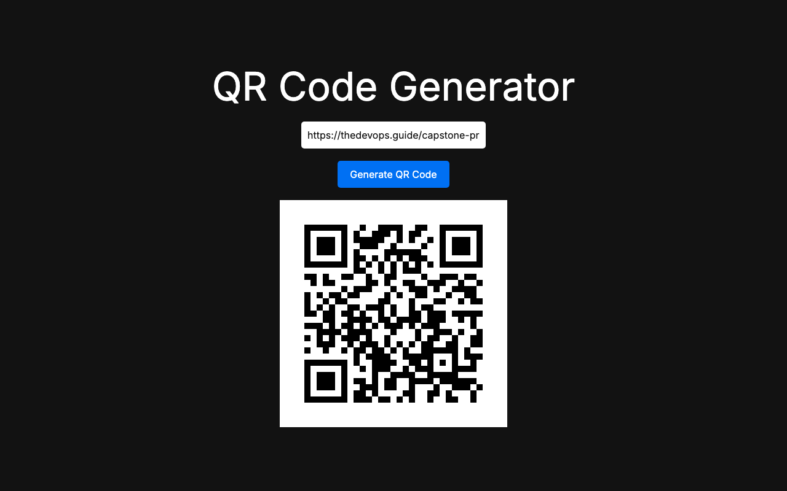

# Evidence

Proof of the AWS run, kept here because the site goes away after `make nuke`. The full list of
checks is in the [README](../README.md#what-has-been-verified).

## Live site

25 Nov 2026, served from EKS through the public load balancer. The QR code was generated on the
page and read back from the private S3 bucket.



`scripts/smoke-test.sh` against the same address, 25 Nov 2026:

```text
==> POST /api/qr -> 201, image_url /api/qr/0f115db062b7c0dd030b16878c99dea5c354b49dc37b38eb8846179c7783e9d7
==> GET /api/qr/0f115db062b7c0dd030b16878c99dea5c354b49dc37b38eb8846179c7783e9d7 -> 200 image/png (555 bytes)
==> smoke test passed: http://abe14d4332a02494d96c1928fc371091-75f7d238fd0c59a7.elb.us-east-1.amazonaws.com
```

## Pipelines

| Run | Trigger | Commit | Jobs | Result |
|---|---|---|---|---|
| [app](https://github.com/MarwanMoh11/devops-qr-capstone/actions/runs/45465024782) | `make release` | `095674b` | test (api, web), manifests, publish (api, web), deploy | success |
| [app](https://github.com/MarwanMoh11/devops-qr-capstone/actions/runs/45470613427) | push to `main` | `4b6e552` | test (api, web), manifests, publish (api, web), deploy | success |
| [infra](https://github.com/MarwanMoh11/devops-qr-capstone/actions/runs/45470614284) | manual | `4b6e552` | static, plan ("No changes") | success |
| [lint](https://github.com/MarwanMoh11/devops-qr-capstone/actions/runs/45470613529) | push to `main` | `4b6e552` | actionlint + shellcheck, hadolint, helm template + kubeconform, dashboard JSON | success |

Each `deploy` job signs in to AWS through OIDC, rolls out `qr-api` and `qr-web` on EKS, and ends
with the smoke test against the public URL.

## Monitoring

Prometheus, Grafana and Container Insights were checked on 24 Nov 2026; the results are in the
README table. There are no screenshots of them. To see the dashboard while the cluster is
up, log in to AWS and run `make grafana`.
